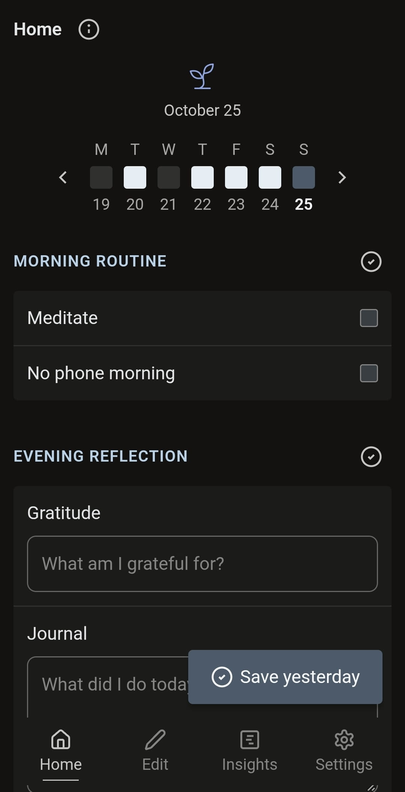
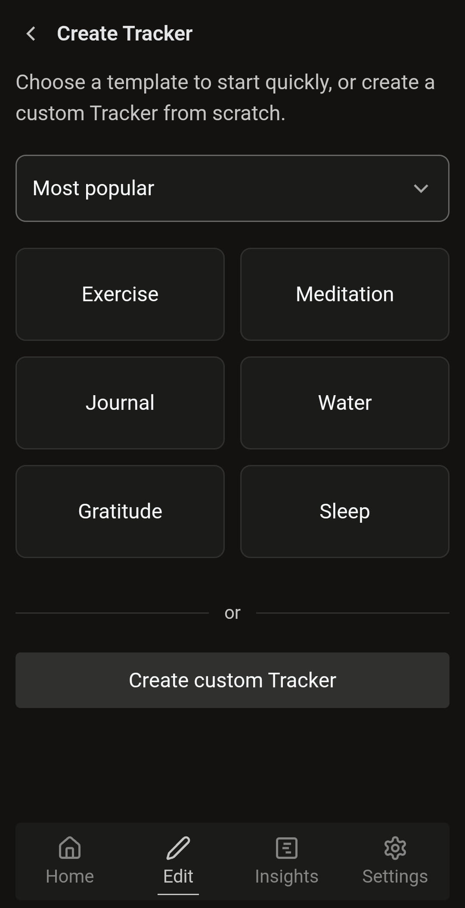
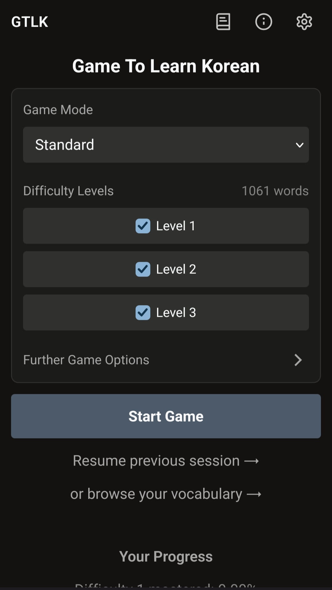
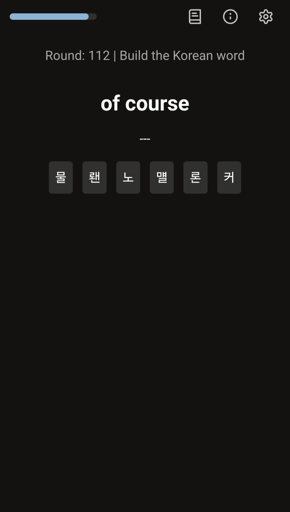
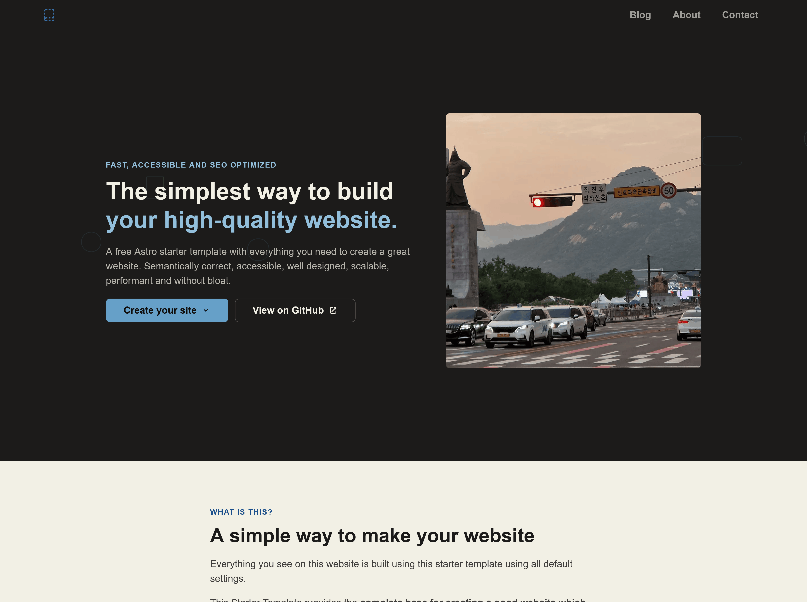

I've gone abroad, lived as a nomad, recently finished my first larger contract as a freelancer, returned to Germany, and am still working on building my own ecosystem of products and services.

So which projects am I working on now, and why?

*This post was published in October 2026, as time goes on my priorities will shift. My [now page](/now) will be kept up to date.*

## DailySelfTrack App

Back in 2024 I began working on an app for self-tracking. I wanted an application that was customizable enough to fit into what I needed, and I couldn't find such a thing on the market. So I explored a solution that combines features from habit trackers, health journals and diary tools into one. Combining these into one seemed powerful, and should provide a lot of insight. Customizable like a spreadsheet, but with much better UI UX for daily usage.

I wanted to visualise how my health has been, having concrete data on how I was feeling and being impacted by some things, find any correlation between different problems I was having and find out what might help or what doesn't help.

I found that doing certain things regularly helps me a lot, e.g. exercise, no-phone mornings or meditation. But actually doing these is difficult. A habit tracker helps here. Whether I stick to these things, how I have been doing and what I'm just up to in general is all interrelated, so I wanted to integrate it into one interface.

My bachelor's final project and thesis was about this. I found people who were really interested in this solution, improved my skills, made a lot of progress, and I continued working on it. Although I have lost some momentum. After graduation I didn't want to stay in Germany, I lived as a (digital) nomad across different places (Seoul, Macau, Mainland China, Osaka, Tokyo), and worked at different places and different things, e.g. a research internship in Macau, hostels in Japan, freelancer for a start-up and more.

But I made progress with this app. I now use it daily. I use it for my health, habits I want to build (exercise / physical activity, meditation) and for keeping a gratitude journal, one entry a day on what I'm grateful for. What I use it for changes with time, but that's the great thing about this app, it can easily be adjusted to that.

I have called this app DailySelfTrack and you can find the landing page with more information on [dailyselftrack.com](https://dailyselftrack.com/).

I sometimes feel like I could do endless more iterations (planning / reflecting, implementing, user testing), but I should publish it on a store now. I do have to put some more work into the logo and similar elements such as the favicon and app icon, but then it should be ready. There's still a lot I want to do with it, some of which you can find on the [roadmap for DailySelfTrack](https://dailyselftrack.com/roadmap/).

So I appreciate anyone who:

1. [Joins DailySelfTrack's mailing list](https://dailyselftrack.com/).
2. [Joins my monthly updates on my work in general](/follow).

## ToLearnKorean

I really enjoyed my time in South Korea. Seoul especially was a truly wonderful city to live in. I felt so motivated to go out and explore the city. One thing that would have made my experience even better would've been excellent Korean skills though. Knowing Korean in Korea is quite helpful.

So I made [ToLearnKorean.com](https://tolearnkorean.com/) and [Game.ToLearnKorean.com](https://game.tolearnkorean.com/). Working on these projects should help me improve my own Korean, creating something motivates me. And I of course would love to use these tools myself, I want there to be good tools and resources for Korean.

[ToLearnKorean.com](https://tolearnkorean.com/) is a content focussed site teaching you the Korean language.

[Game.ToLearnKorean.com](https://game.tolearnkorean.com/) focusses on helping you learn and memorise vocabulary, it combines aspects from Anki and Duolingo.

### Hiragana App

I built [app.tolearnjapanese.com](https://app.tolearnjapanese.com/) to learn Hiragana, one of the Japanese alphabets.

It's an adaption of [Game.ToLearnKorean.com](https://game.tolearnkorean.com/).

## Clean WebDev Guide

Many of the same motivations that led me to create ToLearnKorean also made me build [WebDev.BryanHogan.com](https://webdev.bryanhogan.com/), a site teaching web development. Good educational content about web development is rare. The web can be a wonderful space, but lately it's sadly getting filled with slop, low-quality and astroturfed content. I want to create a place for the opposite of that.

Especially with my background combining development and design (product, UX, UI) I felt like there's a valuable space to fill.

I originally had a few paragraphs about recent changes which are happening due to AI, such as educational content, especially web developer content, becoming increasingly less popular, but I think this deserves its own post.

As I learn new valuable things in web development, I will also add them to [webdev.bryanhogan.com](https://webdev.bryanhogan.com/). Like with my other projects, there's so much I already want to add here that I haven't got around to yet.

## Astro Starter Template

A good web development guide deserves a starter template that shows off the things it teaches, right? I also use it for every web project I start, it makes sense to not start from zero for everything I build.

The landing page on [starter.bryanhogan.com](https://starter.bryanhogan.com/) uses the template with all default values.

It uses the Astro framework, a simple CSS (design) system utilising a token-based approach and allows you to write pages with markdown / mdx. This is much better than using TailwindCSS or some other bloated approach. The UX/UI is also quite clean, none of the typical mistakes I regularly find on other blog and company pages.

## Freelancer

I like freelance projects. I like building good digital experiences for other people and getting paid to do so, but I currently don't have a project going. I should create a website and LinkedIn profile for my services, but I'm currently looking for a full-time position, so I want to focus on that and also not send mixed signals.

## Other projects

I also have some other projects, but I have not been spending a lot of time on these recently.

My [Flow Timer](https://timer.bryanhogan.com/) tool still works well, a simple user-friendly (local-only, no tracking, no ads, no upsell, yet fully free) way to set a group of timers for time-boxing.

My [Obsidian Vault Template](https://github.com/BryanHogan/obsidian-vault-template) as described in my [Obsidian vault setup blog post](/blog/obsidian-vault) is also still there.

## Projects overview

I mention my projects on my [/projects](/projects) page, which I will also continue to keep updated. Here is the list of projects I mentioned in this post, including the GitHub repository if available:

- DailySelfTrack
	- Website: [dailyselftrack.com](https://dailyselftrack.com/)
- Astro Starter Template
	- Website: [starter.bryanhogan.com](https://starter.bryanhogan.com/)
	- GitHub: [github.com/BryanHogan/astro-starter-template](https://github.com/BryanHogan/astro-starter-template)
- ToLearnKorean
	- Website: [tolearnkorean.com](https://tolearnkorean.com/)
	- GitHub: [github.com/BryanHogan/learnkorean](https://github.com/BryanHogan/learnkorean)
- Game.ToLearnKorean.com
	- Website: [game.tolearnkorean.com](https://game.tolearnkorean.com/)
- Clean Web Development Guide
    - Website: [webdev.bryanhogan.com](https://webdev.bryanhogan.com/)
	- GitHub: [github.com/BryanHogan/webdev](https://github.com/BryanHogan/webdev)
- Learn Hiragana Web App:
    - Website: [app.tolearnjapanese.com](https://app.tolearnjapanese.com/)
- Flow Timer:
	- Website: [timer.bryanhogan.com](https://timer.bryanhogan.com/)
	- GitHub: [github.com/BryanHogan/flow-timer](https://github.com/BryanHogan/flow-timer)