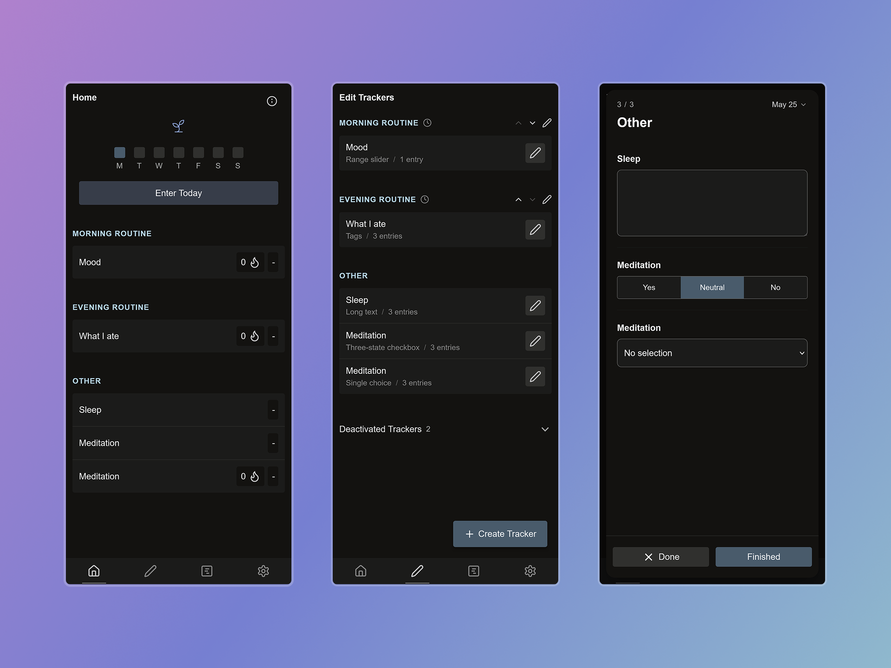

DailySelfTrack is an app for self-tracking. It combines features from habit trackers, health logs and journals into one app. You decide what you want to track, e.g. habits, sleep, mood, symptoms or a gratitude journal, and you can change that whenever your needs change. I use it every day myself.

- Role: solo. I did the research, UX and visual design, development, testing and product decisions.
- Timeline: 2024 to now. It started as my bachelor project and thesis.
- Stack: SvelteKit, Capacitor, Dexie.js
- Status: runs as a web app, PWA and native Android app. A closed beta is running.
- Links: [app.dailyselftrack.com](https://app.dailyselftrack.com/), [dailyselftrack.com](https://dailyselftrack.com/), [roadmap](https://dailyselftrack.com/roadmap/)

## Problem

I wanted an app I could adjust to what I need to track, and I couldn't find one. Most self-tracking apps are rigid. Habit trackers, mood trackers and health logs come with fixed metrics and fixed workflows. Spreadsheets, Notion or Obsidian let you track anything, but they're made for notes, so entering something every day is slow.

My bachelor thesis was about this. It asked whether more customization in a self-tracking app improves usability and market fit, and how to balance flexibility with ease of use.

## Process

1. I looked at market trends and analyzed 29 self-tracking apps, to see which needs they cover and where there's a gap.
2. I ran a survey on how people self-track today and what matters to them, to check the gaps I found in the market analysis.
3. From that I defined the problem: most apps lock you into fixed metrics, and the flexible tools aren't made for daily entries.
4. I created two personas to guide design decisions.
5. I went from sketches to a flowchart to a clickable wireframe in Figma, and tested the wireframe with users.
6. I built the MVP with SvelteKit, Capacitor and custom CSS. You create your own trackers, advanced options stay hidden until you need them, the defaults make the first steps easy, and all data stays on your device.
7. I tested usability and market fit with task-based tests, the SUS questionnaire and follow-up questions.
8. I worked out a Business Model Canvas and evaluated market fit with Dan Olsen's Product-Market Fit Pyramid, based on the competitor analysis and the user tests.

The clickable wireframe in Figma. The links between the screens made it possible to test it with users.

## What testing showed

More customization does work, as long as the extra complexity stays hidden until someone wants it. Progressive disclosure, sensible defaults and help where it's needed were the main ways to get there. Participants also wanted a tool they can keep adjusting when their needs change.

The market analysis and the interviews showed a gap between rigid self-tracking apps and spreadsheet tools. An app that keeps your data private, doesn't force you into a subscription and is aimed at moderately technical users could fill that gap.

## Features

- Tracker types for text, numbers, checkboxes, time, single and multiple choice, sliders and media.
- Trackers can be grouped, e.g. into a "Morning routine", and each group can have its own reminder.
- History as a calendar, chart or heatmap, with streaks and summaries.
- Export to CSV, TSV or JSON. No account needed, it works offline, and your data never leaves your device.

## Implementation

I rebuilt the app twice before I settled on a stack. The first version used React Native with Expo, the second Ionic React with Capacitor. Now it's SvelteKit with Capacitor and Dexie.js. With SvelteKit there's little overhead for styling, changes show up fast while developing, and routing is built in. The data is stored in IndexedDB through Dexie. From one codebase the app runs on the web as a PWA and on Android through Capacitor.

<video width="100%" height="400" aria-label="DailySelfTrack app demo" controls muted>
  <source src="/videos/DailySelfTrack-App-Demo-Video-Portfolio-Bryan-Hogan.mp4" type="video/mp4">
  Your browser does not support the video tag.
</video>

## Looking back

I feel like I could keep doing more rounds of planning, building and user testing forever. But at some point the app has to get into people's hands, so the next step is publishing it in the app stores.

If you want to read the full thesis with the test results, just ask me.

[Back to portfolio](/portfolio)
