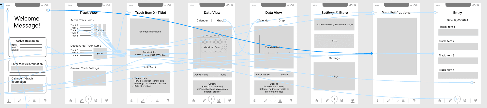

DailySelfTrack is a self-tracking app that combines a habit tracker, a health log and a journal. You decide what to track, such as habits, sleep, mood, symptoms or a gratitude journal, and change it when your needs change. I also use it every day.

- Role: solo. Research, UX and visual design, development, testing and product decisions.
- Timeline: 2024 to now. Started as my bachelor project and thesis.
- Stack: SvelteKit, Capacitor, Dexie.js
- Status: runs as a web app, PWA and native Android app. A closed beta is running.
- Links: [app.dailyselftrack.com](https://app.dailyselftrack.com/), [dailyselftrack.com](https://dailyselftrack.com/), [roadmap](https://dailyselftrack.com/roadmap/)

## Problem

Most self-tracking apps are rigid. Habit trackers, mood trackers and health logs come with fixed metrics and workflows. Spreadsheets, Notion or Obsidian let you track anything, but they're built for notes, so daily entry is slow.

My bachelor thesis asked whether greater customization in a self-tracking app improves usability and market fit, and looked at the trade-off between flexibility and ease of use.

## Process

1. Looked at market trends and analyzed 29 self-tracking apps to see which needs they cover and where there's a gap.
2. Ran a survey on how people self-track today and what they care about, to check the gaps from the market analysis.
3. Defined the problem: most apps lock you into predefined metrics, and the flexible tools aren't made for daily entry. There's room in between.
4. Created two personas to guide design decisions.
5. Went from sketches to a flowchart to a clickable Figma wireframe, and tested the wireframe with users.
6. Built the MVP with SvelteKit, Capacitor and custom CSS. Users define their own trackers, advanced options stay hidden until needed, defaults are sensible, and all data stays on the device.
7. Tested usability and market fit with task-based observation, the SUS questionnaire and follow-up questions.
8. Worked out a Business Model Canvas and evaluated market fit with Dan Olsen's Product-Market Fit Pyramid, based on the competitor analysis and the user tests.

The clickable Figma wireframe, with the links between screens that made it testable.

## What testing showed

Greater customization works if the extra complexity stays out of the way until someone wants it. Progressive disclosure, sensible defaults and contextual help were the main ways to get there. Participants also wanted a tool they could keep adjusting as their needs change.

The market analysis and the interviews showed a gap between rigid self-tracking apps and spreadsheet tools. A privacy-first app without a mandatory subscription, aimed at moderately technical users, could fill it.

## Features

- Tracker types for text, numbers, checkboxes, time, single and multiple choice, sliders and media.
- Trackers can be grouped, e.g. into a "Morning routine", each group with its own reminder.
- History as a calendar, chart or heatmap, with streaks and summaries.
- Export to CSV, TSV or JSON. No account needed, works offline, and data never leaves the device.

## Implementation

I rebuilt the app twice before settling on a stack: first React Native with Expo, then Ionic React with Capacitor, now SvelteKit with Capacitor and Dexie.js. SvelteKit has little styling overhead, a fast dev loop and built-in routing. Data lives in IndexedDB through Dexie. One codebase ships to the web as a PWA and to Android through Capacitor.

<video width="100%" height="400" aria-label="DailySelfTrack app demo" controls muted>
  <source src="/videos/DailySelfTrack-App-Demo-Video-Portfolio-Bryan-Hogan.mp4" type="video/mp4">
  Your browser does not support the video tag.
</video>

## Looking back

I could keep going through rounds of planning, building and user testing forever. At some point the app has to be in people's hands, so the next step is publishing it in the stores.

The full thesis with the test results is available on request.

[Back to portfolio](/portfolio)
